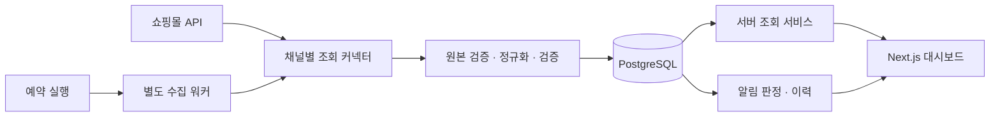

# 통합 재고·주문 관리 시스템 설계

작성일: 2026-10-03. 상태: 구현 전 제안 설계.

2026-10-04 범위 조정: 첫 기획·구현은 네이버 스마트스토어와 쿠팡만 대상으로 한다. 아래 G마켓·옥션·11번가 내용은 후속 확장 참고다. 현재 주제별 정리는 [새 문서 안내](https://app.notion.com/p/3ef15a85fa868135ae78d2102a1ad7b1)에서 읽는다.

사용자 확정 사항은 첫 버전 범위와 개발 규칙이다. 아래 모델, 수집 주기, 경보 정책, 배포 구성은 구현 기준으로 제안하며 실제 API 계약과 계정 검증 결과에 따라 조정한다. 공개 API 근거와 미확인 사항은 [API 준비사항](03-api-readiness.md)에 기록한다.

## 1. 목표와 첫 버전 범위

여러 판매 채널의 상품·옵션 재고와 주문을 한 화면에서 조회한다. 쿠팡 판매자배송과 로켓그로스를 구분하고 내부 SKU로 채널 옵션을 연결한다. 다른 쇼핑몰을 추가할 때 기존 화면과 핵심 모델을 크게 변경하지 않도록 커넥터 경계를 둔다.

| 포함 | 제외 |
| --- | --- |
| 상품·옵션·판매용 재고 조회 | 쇼핑몰 재고 자동/수동 수정 |
| 신규 주문과 지원되는 주문 상태 변경 수집 | 발송 처리·취소 승인·환불·주문 상태 쓰기 |
| 지원되는 취소·반품·교환 조회 | ERP/WMS 실제 보유 재고 연동 |
| SKU 연결 후보 제안·운영자 확정 | 상품 자동 등록·가격 동기화 |
| 부족 재고·연동 장애·데이터 지연 알림 | 로켓그로스 결제 직후 주문의 완전한 실시간 보장 |
| 연동 상태·마지막 성공 시각·알림 이력 | 모든 채널에 동일한 기능이 있다고 가정 |

여기서 주문 상태 갱신은 **조회 결과를 내부 DB에 반영하는 것**이다. 쇼핑몰 주문 상태를 수정하는 호출은 없다. 상품 연결과 알림 설정은 내부 DB에만 저장한다.

## 2. 구조와 권장 배포



- 웹: Next.js 15 App Router, React 19, TypeScript, Tailwind CSS, shadcn/ui.
- 필터·선택 상태: Zustand. 서버 데이터와 API 비밀값은 Zustand에 저장하지 않는다.
- 내부 설정 폼: React Hook Form + Zod. 서버에서도 같은 입력 규칙을 재검증한다.
- DB: PostgreSQL + Prisma. 스키마 버전과 마이그레이션을 관리한다.
- 수집: TypeScript 별도 워커. 초기에는 PostgreSQL의 영속 작업 테이블·리스·재시도 예약을 사용하고, 규모가 커지면 전용 큐를 검토한다.
- 운영: 고정 발신 IP를 가진 서버/VPC에서 워커 실행. 웹 요청 처리와 장기 수집을 분리한다. 화면 조회로 수집을 유발하지 않는다.
- 워커 프로세스와 예약 실행은 서버 시작 시 자동 복구할 수 있어야 한다. Next.js 프로세스 내부 타이머에만 의존하지 않는다.

같은 스택을 Windows·macOS·Linux에서 개발하는 방안과 GitHub 환경 재현 조건은 [다중 OS 개발 환경 검토](04-development-portability.md)를 따른다. 실제 OS별 설치·빌드는 아직 검증 전이다.

### 코드 구조 제안

```text
src/
  app/                         # 화면과 내부 서버 조회 경로
  components/                  # 공통 테이블, 필터, 배지, 상태 화면
  features/
    dashboard/
    inventory/
    orders/
    mappings/
    integrations/
  stores/                      # Zustand 필터 상태
  server/
    repositories/              # Prisma 조회·저장
    services/                  # 화면 조회, 상품 연결, 알림 설정
    connectors/
      contracts/               # 공통 타입, 기능 지원, 오류
      naver/
      coupang-seller/
      coupang-rocket-growth/
      esm/                     # G마켓·옥션 공유 인증/호출 제한
      elevenst/
      fixture/
    sync/                      # 페이지 수집, 검증, 체크포인트
    alerts/                    # 판정, 반복 억제, 복구
    security/                  # 인증, 비밀값, 마스킹
workers/                       # 수집·예약 실행 진입점
prisma/                        # 스키마 및 마이그레이션
fixtures/                      # 실제 개인정보·비밀값 없는 샘플
tests/                         # 커넥터·수집·주요 화면 검증
docs/
```

이는 예정 구조이며 아직 해당 코드 파일은 없다. 커넥터·DB 모듈은 서버 전용으로 지정하고 클라이언트에서 가져올 수 없게 한다.

## 3. 채널·계정·기능 지원

한 채널에 여러 판매자 계정을 연결할 수 있게 설계한다. 모든 레코드와 조회는 조직·계정 범위를 포함한다. 첫 버전 UI는 한 운영 조직을 대상으로 하되 계정 간 식별자 충돌을 방지한다.

| 논리 채널 | 배송 구분 | 주문 가시성/확인 과제 |
| --- | --- | --- |
| `naver` | `seller` | 변경 상품주문과 상세 조회 조합 |
| `coupang` | `seller` | 일반 발주서·클레임 API |
| `coupang` | `rocket_growth` | 출고일 이후 조회, 상태 변경·클레임 지원 별도 확인 |
| `gmarket` / `auction` | 계약에서 확인한 배송 구분 | ESM 일반 주문·클레임 별도 조회 |
| `elevenst` | 계약에서 확인한 배송 구분 | 계정 가이드에서 상세 필드·클레임 지원 확인 |

쿠팡의 계정은 공유할 수 있지만 커넥터와 재고·주문 수집 범위는 배송 방식별로 나눈다. G마켓·옥션은 사이트를 별도 채널로 저장하면서 ESM 마스터 계정·인증·호출 제한 그룹을 공유할 수 있다. 배송 구분이 없는 응답을 임의로 판매자배송으로 확정하지 않고 `unknown`을 허용한다.

기능 지원 값은 `supported`, `unsupported`, `unverified`로 나눈다. 로켓그로스 상태/클레임 등 미확인 기능은 구현 약속이나 빈 정상 결과로 표현하지 않는다. 11번가는 공개 소개에서 상품·재고·주문·클레임 조회의 존재를 확인했지만 상세 필드·상태·페이지 계약은 계정 확인 전이다. 화면에는 "미지원"과 "지원 여부 확인 중"을 구분한다.

## 4. 재고 의미와 상태 모델

### 수량 의미

| `quantityType` | 의미 | 원천/범위 |
| --- | --- | --- |
| `channel_listed` | 쇼핑몰에 판매용으로 등록된 수량 | 스마트스토어 `stockQuantity`, 쿠팡 판매자배송 `amountInStock` 등 |
| `rg_orderable` | 로켓그로스 주문가능 수량 | `totalOrderableQuantity` |
| `physical_on_hand` | 실제 보유 재고 | 첫 버전 미지원; 향후 ERP/WMS 별도 연동 |

`salesQuantity`는 주문 판매수량으로 `OrderLine.quantity`에 저장한다. 재고 필드로 변환하지 않는다. 여러 채널의 판매용 수량은 같은 실제 재고를 참조할 수 있으므로 채널 간 합산을 실제 보유량으로 표시하지 않는다. 로켓그로스 주문가능 수량 역시 전체 창고 재고와 같다고 가정하지 않는다.

### 값·수집·신선도는 별도 축

| 축 | 값 | 규칙 |
| --- | --- | --- |
| 값 상태 `valueState` | `available`, `stock_management_disabled`, `unsupported`, `unknown` | 의미 있는 수량은 `available`일 때만 존재 |
| 최근 시도 `readState` | `success`, `failed`, `pending`, `not_connected` | 실패를 0이나 빈 성공으로 바꾸지 않음 |
| 신선도 `freshness` | `fresh`, `stale`, `never_succeeded` | 서버 시간과 마지막 성공 시각으로 계산 |
| 데이터 출처 `sourceMode` | `live`, `fixture` | 계정·응답·행에 출처 표시 |

- `quantity=0`과 `valueState=available`은 정상 품절이다.
- 첫 조회 실패: 성공값 없음, `quantity=null`, `readState=failed`, `never_succeeded`.
- 성공 후 실패: 마지막 성공값 유지, 최근 시도는 실패, 실패 시각·오류를 함께 표시한다. 신선도는 경과 시간에 따라 계산한다.
- 재고 관리 미사용: 정규화 수량은 `null`; 원본 수량은 제한된 원본 저장에 남길 수 있다. 네이버의 큰 기본 수량을 실제 보유 재고로 해석하지 않는다.
- 미지원: `quantity=null`, `valueState=unsupported`; 장애와 구분한다.
- 부분 수집: 자원별 `partial` 실행 상태. 전체 성공 시각·체크포인트를 진전시키지 않는다.

**불변 조건:** 성공한 재고 관측을 실패 응답으로 덮어쓰지 않는다. 빈 응답·누락 필드·실패·삭제 추정을 0으로 변환하지 않는다. 주문 수량을 빼서 채널 조회 재고를 다시 계산하지 않는다.

초기 신선도 제안은 마지막 성공 후 목표 주기의 2배 경과 시 `stale`이다. 정기 수집 주기와 별도로 자원별 기준을 설정하고 장애는 첫 실패부터 표시한다. fixture에는 실제 수집 신선도를 적용하지 않고 "샘플 기준시각"을 표시한다.

## 5. 데이터 모델

외부 식별자는 숫자로 보여도 문자열로 저장한다. 시간은 원본 시간대 확인 후 UTC `timestamptz`로 저장하고 화면에서 Asia/Seoul로 표시한다. 금액은 부동소수점 대신 DB Decimal과 통화 코드를 사용한다.

| 모델 | 주요 필드 | 관계·제약 |
| --- | --- | --- |
| `Organization` / `User` | 조직, 역할, 활성 상태 | 관리자·조회자 구분, 모든 서버 쿼리 조직 범위 검증 |
| `CredentialProfile` | 공급자, 비밀 저장소 참조, 인증 상태, 마지막 성공 호출, 만료/갱신 가능시각 | 키 원문을 화면 응답에 포함하지 않음; ESM 공유 자격증명 가능 |
| `ChannelAccount` | 조직, 채널, 외부 판매자 ID, credentialProfileId, sourceMode | 동일 채널 다계정 지원; live/fixture 식별 공간 분리 |
| `InternalSku` | 조직, skuCode, 상품명, 옵션 속성, 활성 상태 | 조직 내 skuCode 유일; 상품명은 키가 아님 |
| `ChannelProduct` | accountId, externalProductId, esmMasterProductId, siteProductId | ESM 마스터와 사이트 ID 동시 보존 |
| `ChannelOption` | productId, nativeEntityKey, externalOptionId, vendorItemId, 판매자 SKU | 계정 내 nativeEntityKey 유일; 원본 식별자 보존 |
| `SkuMapping` | internalSkuId, channelOptionId, 승인자·시각, version | 옵션당 활성 내부 SKU 1개; 동일 SKU에 여러 채널 옵션 허용 |
| `MappingCandidate` | 후보 SKU·옵션, 근거, 점수, 제안 상태 | 자동 확정 금지; 중복·불일치 검토 후 승인 |
| `InventoryObservation` | accountId, channelOptionId, fulfillmentType, quantityType, quantity, valueState, observedAt, sourceUpdatedAt, runId | 성공 관측의 이력; 미지원·미사용은 nullable 수량 |
| `InventoryCurrent` | 관측 차원, latestObservationId, lastSuccessAt | 최신 성공 관측 포인터; 실패 시 포인터 유지 |
| `Order` | accountId, externalOrderId, fulfillmentType, 원본/정규화 상태, paidAt, sourceUpdatedAt | 계정·배송 방식·외부 주문 ID 유일 |
| `OrderLine` | orderId, externalLineId, channelOptionId, quantity, 금액·통화, 원본/정규화 상태 | 주문 내 원본 행 ID 유일; 행별 상태 및 SKU 연결 가능 |
| `OrderStatusEvent` | order/line 식별자, 원본 상태, 발생시각, 소스 eventKey | 동일 이벤트 재수집 중복 방지 |
| `Claim` / `ClaimLine` | externalClaimId, type, 원본/정규화 상태, 주문·행, 수량, occurredAt | 취소·반품·교환 별도; 부분 클레임 수량 보존 |
| `SyncState` | accountId, connectorKey, resource, strategyKey, lastAttemptAt, lastSuccessAt, 실패 횟수, checkpoint | 계정·배송·자원·신규/변경/대조 전략별 독립 상태 |
| `SyncRun` / `SyncPage` | 조회 구간, 원본 cursor, 페이지 수, 수집/검증 건수, 상태, 오류 | `queued/running/succeeded/partial/failed/skipped` 구분 |
| `CollectionJob` | scheduledAt, retryAt, leaseUntil, leaseOwner, fencingToken, attempt, dedupeKey | 영속 예약·리스·오래된 워커의 쓰기 차단 |
| `RawPayload` | accountId, runId, resource, 마스킹된 응답/해시, schemaVersion, expiresAt | 제한적 보관, 접근 제한, 자동 삭제 |
| `AlertRule` / `AlertEvent` | 계정·옵션·재고 의미, 임계값, fingerprint, 상태, 최초/최종 발생·해결시각 | 샘플 알림과 운영 알림 분리; 중복 억제 |
| `AuditLog` | 변경자, 내부 설정/매핑 변경, 대상, 시각 | 비밀값·개인정보 기록 금지 |

### 식별·무결성 원칙

1. 모든 외부 ID의 고유 키에 계정 범위를 포함한다. 동일 ID가 다른 판매자 계정에 나타나도 충돌하지 않는다.
2. 옵션 ID가 없는 단일 상품은 커넥터가 원본 상품 ID에 기반한 `nativeEntityKey`를 만든다. 옵션명·배열 순서·상품명으로 키를 만들지 않는다. 필수 식별자가 없으면 검증 오류로 격리한다.
3. 재고 차원은 계정·옵션·배송 방식·수량 의미·원천이 제공하는 위치/창고 차원을 포함한다. 창고별 행과 전체 합계가 함께 나오면 중복 합산하지 않는다.
4. 조회 재고에는 매핑이 없어도 원본 옵션을 보존한다. 화면에 "미연결"로 표시해 SKU 연결 후 같은 데이터를 사용할 수 있게 한다.
5. 매핑 변경 이력을 남긴다. 주문의 원본 옵션은 변경하지 않으며 수집 시 SKU/매핑 버전을 이력으로 보존한다. 과거 주문을 현재 매핑으로 볼 때는 현재 기준임을 표시한다.
6. 주문·클레임의 원본 상태는 항상 보존한다. 모르는 상태는 `unknown`으로 표시하고 원문 코드를 남긴다. RG 응답에 상태가 없으면 "상태 미제공"으로 표시한다.
7. 클레임이 주문보다 먼저 도착하면 외부 주문/행 ID로 임시 보관 후 재연결한다. 정상 주문 수량을 클레임 수량으로 덮어쓰지 않는다.
8. fixture 레코드는 운영 통계·부족 재고 판정에서 제외한다. 운영 계정과 샘플 계정의 키 공간을 분리한다.

구현 시 nullable 복합 고유 키의 PostgreSQL 동작을 확인하고, 재고 차원을 직렬화한 비어 있지 않은 `scopeKey` 등에 명시적 unique 제약을 둔다. 조회 인덱스는 계정·수집 시각, 주문 날짜·상태·배송 방식, SKU·옵션, 미해결 알림에 둔다.

## 6. 공통 조회 커넥터 계약

아래는 설계용 TypeScript 초안이다. 각 원본 응답 스키마와 실제 구현은 후속 단계에서 작성한다. 인터페이스에는 쇼핑몰 쓰기 메서드를 두지 않는다.

```typescript
type Resource = 'products' | 'inventory' | 'orders' | 'claims';
type SupportState = 'supported' | 'unsupported' | 'unverified';
type FulfillmentType = 'seller' | 'rocket_growth' | 'unknown';
type ClaimType = 'cancel' | 'return' | 'exchange';
type QuantityType = 'channel_listed' | 'rg_orderable';
type QueryTimeBasis =
  | 'source_changed'
  | 'created'
  | 'paid'
  | 'claim_received'
  | 'none';
type ValueState =
  | 'available'
  | 'stock_management_disabled'
  | 'unsupported'
  | 'unknown';

type JsonValue =
  | string
  | number
  | boolean
  | null
  | JsonValue[]
  | { [key: string]: JsonValue };

interface ConnectorCapabilities {
  resources: Record<Resource, SupportState>;
  orderStatusChanges: SupportState;
  claims: Record<ClaimType, SupportState>;
  orderVisibility: 'payment_or_change' | 'after_shipment' | 'unverified';
}

interface CollectionScope {
  accountId: string;
  fulfillmentType: FulfillmentType;
  queryTimeBasis: QueryTimeBasis;
  from: string;
  to: string;
  cursor: string | null;
  entityKeys?: readonly string[];
  signal: AbortSignal;
}

interface NormalizedRecord {
  nativeEntityKey: string;
  sourceUpdatedAt: string | null;
}

interface ProductRecord extends NormalizedRecord {
  externalProductId: string;
  externalOptionId: string | null;
  sellerSku: string | null;
  productName: string;
  optionName: string | null;
  esmMasterProductId: string | null;
  siteProductId: string | null;
}

type InventoryValue =
  | { valueState: 'available'; quantity: number }
  | {
      valueState: Exclude<ValueState, 'available'>;
      quantity: null;
    };

type InventoryRecord = NormalizedRecord & InventoryValue & {
  quantityType: QuantityType;
  fulfillmentType: FulfillmentType;
  locationKey: string | null;
  observedAt: string;
};

interface OrderLineRecord extends NormalizedRecord {
  externalLineId: string;
  optionEntityKey: string | null;
  quantity: number;
  rawStatus: string | null;
  unitPrice: string | null;
  currency: string | null;
}

interface OrderRecord extends NormalizedRecord {
  externalOrderId: string;
  fulfillmentType: FulfillmentType;
  rawStatus: string | null;
  paidAt: string | null;
  lines: readonly OrderLineRecord[];
}

interface ClaimRecord extends NormalizedRecord {
  externalClaimId: string;
  externalOrderId: string;
  externalLineId: string | null;
  claimType: ClaimType;
  quantity: number | null;
  rawStatus: string;
}

interface RateLimitHint {
  retryAfterMs: number | null;
  remaining: number | null;
  resetAt: string | null;
  quotaGroup: string;
}

interface CollectionPage<T extends NormalizedRecord> {
  records: readonly T[];
  nextCursor: string | null;
  isLastPage: boolean;
  rawPayload: JsonValue;
  rateLimit: RateLimitHint | null;
}

interface ChannelConnector {
  key: string;
  capabilities: ConnectorCapabilities;
  fetchProducts(scope: CollectionScope): Promise<CollectionPage<ProductRecord>>;
  fetchInventory(scope: CollectionScope): Promise<CollectionPage<InventoryRecord>>;
  fetchOrders(scope: CollectionScope): Promise<CollectionPage<OrderRecord>>;
  fetchClaims(scope: CollectionScope): Promise<CollectionPage<ClaimRecord>>;
}
```

호출 전 `capabilities`를 확인한다. 미지원 메서드는 구조화된 `UNSUPPORTED` 오류, 미확인 기능은 `UNVERIFIED` 오류로 중단하며 빈 정상 페이지를 반환하지 않는다. 기간을 받지 않는 재고 API는 `from/to`를 조회 범위로 보내지 않고 내부 실행 범위·기록 시각에만 사용한다.

공통 오류는 `AUTH`, `PERMISSION`, `RATE_LIMIT`, `TRANSIENT`, `VALIDATION`, `UNSUPPORTED`, `UNVERIFIED`, `PERMANENT`로 분류하고 자원·재시도 가능 여부·HTTP 코드·안전한 메시지를 포함한다. 비밀값·전체 응답을 예외 메시지에 넣지 않는다.

`unknown` 원본 응답 → 채널별 Zod 스키마 → 정규화 → 공통 Zod 스키마 → 저장 순서를 적용한다. 수량은 유한 정수·허용 범위를 검증하고 시간·통화·ID·상태 코드를 검증한다. 필드 추가에는 유연하되 필수 필드 누락과 형식 변경은 격리·알림 대상으로 처리한다. 11번가 XML을 사용하는 경우 외부 엔티티를 비활성화한 파서를 사용한다.

네이버의 변경 ID 조회 후 주문 상세 조회처럼 여러 요청을 합쳐야 하는 채널은 커넥터 내부에서 처리한다. 일부 상세 요청이 실패하면 해당 페이지를 성공으로 반환하지 않는다. `moreFrom + moreSequence`, `nextToken`, 페이지 번호 등의 원본 페이지 정보를 커넥터별 cursor로 보존한다.

## 7. 수집·복구 흐름

### 초기 주기 제안

| 자원 | 초기 제안 | 조정 기준 |
| --- | --- | --- |
| 신규/변경 주문 | 3분 | 사용자 범위 2~5분, 채널 조회 범위·총 요청 수 고려 |
| 취소·반품·교환 | 3~5분, 지원되는 API별 작업 | 클레임 조회 범위·제한 별도 적용 |
| 재고 | 15분 | 사용자 범위 10~30분, 옵션 수·페이지 수 고려 |
| 상품·옵션 목록 | 6시간 및 초기 연결 시 | 수정 빈도·목록 비용 |
| 주문·클레임 대조 | 매일, 기간 분할 | 지연 반영·누락 및 API 허용 기간 |

이는 검토용 시작값이다. 옵션별 호출 API의 총 요청 수를 계산해 호출 제한 안에 들어오지 않으면 주기를 늘리거나 범위를 분할한다. 매일 대조의 조회 범위는 채널 계약과 반영 지연을 확인해 확정한다.

### 채널별 주문 수집 전략

조회 날짜의 의미를 커넥터 계약에 명시한다. 생성일 기준 API에서 짧은 겹침 조회만 하는 것으로 과거 주문의 상태 변경을 수집했다고 판정하지 않는다. 신규 조회, 변경 감시, 정기 대조에 별도 `strategyKey`와 체크포인트를 둔다.

| 채널 | 신규/변경 조회 기준 | 기존 주문·클레임 대조 |
| --- | --- | --- |
| 스마트스토어 | 원천 변경시각 기준 스트림, 전체 cursor 처리 후 상세 조회 | 변경 스트림에서 주문·클레임 반영, 기간별 상세 대조 |
| 쿠팡 판매자배송 | 생성일 기준 발주서를 상태별 조회해 신규 주문 수집 | 기존 미완료 주문의 생성일 구간/주문 ID 재조회; 취소·반품·교환은 접수·수정시각 등 API별 기준으로 별도 조회 |
| 쿠팡 로켓그로스 | 결제일 구간 조회, 출고 이후에 등장 가능 | 출고 지연을 고려해 과거 결제일 구간 반복 대조; 상태/클레임 변경 지원은 미확인 |
| G마켓·옥션 | 일반 주문의 조회 시간 필드·변경시각 지원은 계정 계약에서 확정 | 미완료 주문·기존 클레임 재조회와 기간별 전체 대조; 요청 기간은 API별 제한으로 분할 |
| 11번가 | 생성/결제/변경 기준과 증분 지원을 로그인 가이드에서 확정 | 기준 확정 전 checkpoint 전략을 구현 완료로 취급하지 않음; 기존 주문·클레임 대조 경로 확인 |

미완료 주문 감시 목록을 DB에 유지하고 해당 채널이 지원하는 상세 ID 조회 또는 원래 생성일 구간 재조회로 오늘의 상태를 확인한다. 종료 주문도 클레임 가능 기간·원천 반영 지연을 확인해 정기 대조한다. 접수일 기반 클레임 역시 이전 접수 건의 완료/철회를 놓치지 않도록 기존 건을 재확인한다. 조회 가능 기간과 운영 감시 범위가 맞지 않으면 그 한계를 화면과 운영 문서에 표시한다.

### 실행 순서

1. 예약 작업 생성 → 계정·커넥터·자원별 분산 리스 획득. 획득 시 증가하는 `fencingToken`과 소유자를 기록한다. 저장 트랜잭션에서 행 잠금 또는 조건부 갱신으로 현재 토큰·소유자·리스 유효성을 확인해 리스가 만료된 이전 워커의 늦은 커밋을 차단한다.
2. 전략별 마지막 **연속 완료된** 체크포인트에서 조회 시작시각을 계산한다. 원천 변경시각 증분 API에 겹침 구간을 두고, 초기 제안 15분은 실제 필드·기간·지연 검증 후 조정한다. 생성일 API의 기존 주문 감시와 과거 구간 대조는 위 별도 전략으로 실행한다.
3. 원본과 정규화를 검증하며 모든 페이지를 임시 저장한다. ID 목록만 받고 상세 조회를 생략한 상태는 성공이 아니다.
4. 페이지 cursor 반복·중복과 최대 조회 기간을 확인한다. 끝 페이지를 확인하지 못하면 `partial/failed`로 기록한다.
5. 검증된 전체 범위를 DB 트랜잭션으로 반영하고 성공 관측·주문/클레임 이력·`lastSuccessAt`·체크포인트를 함께 갱신한다. 큰 범위는 시간/상품 묶음으로 분할하고 전체 묶음 목록·완료 상태를 영속 관리한다. 뒤 묶음이 성공해도 앞의 실패 구간을 건너뛰어 checkpoint를 전진시키지 않는다. 전체 성공시각은 범위 전체 완료 시에만 갱신하고, 묶음별 성공값은 그 범위와 시각을 표시한다.
6. 알림 작업을 같은 트랜잭션에 영속 등록하고 별도 처리한다. 저장 성공 뒤 프로세스가 종료되어도 판정을 재개한다.
7. 페이지/검증 실패 시 기존 현재값·완료 체크포인트는 보존한다. 실패 시도·재시도 예약·격리된 레코드 이력만 추가한다.

최신값이 없는 상태에서 유효 일부 페이지만 임의로 정상 데이터처럼 공개하지 않는다. 임시 데이터는 운영 통계에 포함하지 않는다. 자원별 완료 시각을 사용하므로 주문 성공이 재고의 성공시각을 갱신하지 않는다.

### 중복·순서·누락 처리

- 주문·행·클레임의 안정적인 외부 식별자와 계정 범위로 멱등 upsert한다. 한 주문의 복수 행과 부분 클레임을 유지한다.
- 원천 변경시각/버전이 있는 경우 이전 버전은 현재값을 덮어쓰지 않고 이력에 보존한다. 같은 시각은 원천 버전·정규화 해시를 비교한다.
- 상태 변경시각이 없으면 순서를 확정했다고 표현하지 않는다. 직렬 수집·조회 기준시각·정기 상세 재조회로 확인하고 충돌은 격리한다. 상태를 단순 숫자 순서로 제한하지 않는다.
- 겹친 조회와 주기적 대조를 함께 적용한다. 워커 중단 시 저장 완료한 범위를 재처리해도 중복이 없어야 한다.
- 재고 목록에서 사라졌다는 이유만으로 품절/삭제 처리하지 않는다. 전체 목록 성공과 원천의 삭제/판매중단 신호를 대조한다.
- 로켓그로스는 출고 지연을 고려한 날짜 재조회가 필요하다. 결제 직후 주문을 모두 수집했다고 판정하지 않는다.

### 호출 제한과 재시도

- 인증/계정/공유 API 제한 그룹별 분산 호출 예산과 동시성 제한을 둔다. ESM 두 사이트의 공유 자격증명이 같은 제한을 쓰는지 계정에서 확인한다.
- 네이버 응답 제한 헤더, `Retry-After` 등 실제 응답 힌트를 우선한다. 공개 수치와 계정 제한은 준비 문서에 기록한다.
- 429/일시적 5xx/네트워크 시간초과는 지수 지연과 무작위 분산을 적용한다. 초기 최대 5회 제안 후 지연 실패 상태로 전환한다.
- 401은 해당 인증 규칙에 맞춰 토큰 재발급/서명 재생성 1회 확인 후 지속 실패 시 중단한다. 403·권한/IP 오류·검증 오류는 무한 재시도하지 않는다.
- 작업 시간 제한·리스 갱신·취소를 지원하고 중단된 실행을 재개/실패 처리한다. 서버 시간을 동기화해 서명·UTC 변환 오류를 줄인다.

## 8. 화면과 표시 규칙

| 화면 | 주요 정보·행동 | 반드시 표시할 상태 |
| --- | --- | --- |
| 대시보드 `/` | 채널·배송별 주문, 부족 재고, 연동 장애·지연 | 범위·집계 기준·출처·마지막 성공; RG 출고 이후 한정 |
| 통합 재고 `/inventory` | SKU·상품·옵션·채널별 수량, 배송 방식, 임계값 | 수량 의미, 미연결, 0/미지원/미사용/실패, 확인 시각 |
| 통합 주문 `/orders` | 채널·계정·기간·배송 방식·상태 필터, 클레임 표시 | 행별 상태/수량, 원본 상태, 상태 미제공, 날짜 기준 |
| 상품 연결 `/mappings` | SKU 검색·생성, 후보 검토·확정·해제 | 계정·사이트·외부 ID, ESM 마스터/사이트 ID, 변경 이력 |
| 연동·알림 `/integrations` | 계정 상태, 자원별 수집, 임계값, 알림 이력 | 권한/IP/만료 과제, 마지막 시도·성공, 실패 이유 |

- 라이브가 없는 첫 화면에 "실제 연동 미설정"을 표시한다. fixture를 제공할 때 상단과 행에 "샘플 데이터 · 실제 API 미연동"을 표시한다.
- 라이브와 fixture가 함께 있을 때 기본 운영 통계에는 live만 포함한다. 샘플 모드를 별도로 선택해야 fixture를 볼 수 있게 한다.
- 주문 기간 필터에 결제일·변경일·출고일 중 어떤 기준인지 명시한다. 해당 시간 필드가 없으면 같은 날짜로 추정하지 않는다.
- 대시보드의 RG 주문 수에는 "출고 이후 조회 가능" 표시를 붙인다. 채널별 가시성이 다른 주문 수를 총 신규 주문처럼 비교하지 않는다.
- 재고가 있는 마지막 성공 행에 실패 배지와 "마지막 성공 10:00 / 최근 실패 10:15"를 함께 표시한다.
- UI 상태는 `loading`, `empty`, `error`, `stale`, `partial`, `unauthorized`를 구분한다. 오류를 "주문 없음"으로 표현하지 않는다.
- 서버에서 필터·정렬·페이지 처리를 수행한다. Zustand에는 화면 선택만 저장하고 URL 쿼리와 공유 가능한 필터를 동기화한다.
- 360px은 카드/핵심 열 우선·필터 접기, 768px은 축약 표, 1440px은 상세 표를 제안한다. 표는 좁은 화면에서 필요한 경우 가로 스크롤을 제공한다. 키보드 조작·배지 텍스트·폼 오류를 지원한다.

## 9. 알림 정책

첫 버전의 기본 알림 전달은 앱 내부 이력과 미해결 알림이다. 외부 이메일·메신저는 전달 채널 결정 후 추가할 수 있는 구조로 두며 현재 발송하지 않는다.

- 부족 재고: 계정·SKU/옵션·배송 방식·수량 의미별 임계값. 기본 판정은 신선한 `available` 수량이 임계값 이하일 때다.
- `null`, 실패, 미지원, 미사용, fixture는 운영 부족 재고로 판정하지 않는다. 마지막 값이 오래되면 기존 알림에 지연 표시를 유지하고 새 수량 알림 대신 데이터 지연 경보를 낸다.
- 연결 실패: 첫 실패는 화면에 표시. 반복 실패 3회 또는 지연 기준 초과 시 별도 장애 알림을 제안한다. 인증·권한 오류는 즉시 운영 알림 대상으로 한다.
- fingerprint는 조직·계정·자원/옵션·규칙으로 구성한다. 같은 미해결 상황은 최초 1회 생성하고 이후 발생 시각·횟수만 갱신한다.
- 부족 재고 경보는 신선하고 유효한 수량이 임계값을 초과할 때만 해결한다. 조회가 복구되어도 수량이 낮으면 경보를 유지한다. 연결/데이터 지연 경보는 해당 자원이 성공하고 신선도 기준을 만족할 때 해결한다. 재발 시 새 발생 이력을 만들고 해결 확인을 알린다.
- 알림 확인과 실제 해결은 구분한다. 규칙 변경·알림 확인·매핑 변경은 감사 이력을 남긴다.

## 10. 보안·운영 기준

- 계정 연결·SKU 변경·알림 설정은 관리자만 수행하고 조회자는 읽기만 가능하도록 서버에서 검증한다. 다른 조직/계정 ID를 전달해도 권한을 우회할 수 없어야 한다.
- API 키·비밀키는 서버 비밀 저장소를 사용한다. 로컬 개발 `.env`는 Git 제외·`NEXT_PUBLIC_` 금지, 운영 DB에는 참조만 저장하는 구성을 우선한다. 예시 파일에는 빈 값/플레이스홀더만 둔다.
- 키는 마스킹한 식별 정보만 화면에 반환한다. 인증 헤더·HMAC 원문·JWT·개인정보는 로그와 fixture에 남기지 않는다.
- 첫 버전 조회에 불필요한 주소·전화번호·수취인명은 저장하지 않는 것을 기본으로 한다. 주문 운영에 추가 정보가 필요한 경우 수집 목적·노출 권한·보관 정책을 별도 확정한다.
- 원본 응답은 필요 필드만 남기거나 마스킹·암호화·접근 제한·만료 삭제를 적용한다. 기본 원본 보관 7일은 제안값이며 운영 목적·정책 확인 후 확정한다.
- HTTP 쓰기 요청의 인증·입력 검증·위조 요청 방지, 화면 출력의 안전한 처리, DB 백업·복구 검증을 운영 전 완료한다.
- 운영 지표: 자원별 마지막 성공 지연, 실패/429 횟수, 페이지 수, 처리/격리 건수, 미매핑 옵션 수, 미해결 알림 수. 비밀값을 노출하지 않는 로그 correlation ID로 실행을 추적한다.

## 11. 구현 전 확인 과제

| 과제 | 설계 기본값 | 실제 확정 시점 |
| --- | --- | --- |
| 채널별 계정 수·상품/옵션 수·주문량 | 다계정 모델, 서버 페이지 처리 | S0 계정·볼륨 조사 |
| API 권한·고정 IP·승인 | 미확인, 실연동 차단 조건 | 채널별 실제 조회 전 |
| RG 상태 변경·클레임 지원 | `unverified`, 화면에 지원 미확인 | 추가 공식 가이드·실계정 확인 |
| 11번가 상세 원본/옵션·클레임·시간/페이지·호출 제한 | 조회 기능 존재는 공개 확인, 상세 계약은 `unverified` | 로그인 가이드 및 계정 샘플 확인 |
| 11번가 키 만료/갱신 | 공개 FAQ의 180일/호출 자동 연장 정책, 화면의 실제 만료일 우선 | 실제 계정의 키 관리·호출 기록 대조 |
| 단일 상품·ESM 옵션 식별자 | 안정적인 원본 ID, 임의 이름 매핑 금지 | 원본 응답/가이드 검증 |
| 실제 수집 주기·겹침·대조 기간 | 위 초기 제안 | 요청 예산 계산과 실측 |
| 사용자 로그인 수단 | 인증 및 관리자/조회자 역할 필수 | 기본 앱 구성 단계 |
| 외부 알림 전달 수단 | 앱 내부 이력 우선 | 외부 전달 요구 확정 후 |
| 주문/원본 보관 정책 | 최소 저장·마스킹, 원본 7일 제안 | 운영 데이터 저장 전 |

위 과제 때문에 설계·fixture·화면 작업을 중단할 필요는 없다. 미확인 기능의 실제 연동 완료 표시는 해당 검증까지 보류한다.
