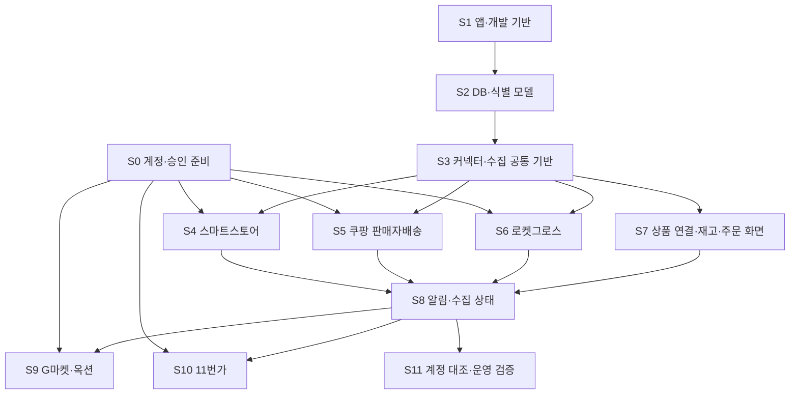

# 단계별 구현 작업 목록

작성일: 2026-10-03. 상태: 문서 작성 완료, 앱·DB·실제 연동 구현 전.

2026-10-04 범위 조정: 아래 목록은 전체 확장을 포함한 상세 참고 자료다. 첫 버전은 네이버·쿠팡 중심으로 S0~S8과 해당 기능의 S11 검증을 진행한다. S9·S10은 이후 확장이며 첫 버전 출시의 선행 조건이 아니다. 읽기 쉬운 현재 기획은 [주제별 문서 안내](https://app.notion.com/p/3ef15a85fa868135ae78d2102a1ad7b1)를 따른다.

체크 표시는 실제 수행 결과를 기준으로 갱신한다. API 사용 승인은 채널별로 관리하고 fixture 성공으로 실제 연동 항목을 완료 처리하지 않는다. 각 채널의 실패는 다른 채널의 구현을 막지 않지만 운영 완료 범위에서는 제외한다.

## 완료한 첫 작업

- [x] 프로젝트 폴더와 숨김 항목 점검: 문서 작성 전 0개.
- [x] 루트·상위 `AGENTS.md`, `.git`, `package.json`, `.env` 존재 여부 확인.
- [x] 사용자 제공 개발 규칙을 새 `AGENTS.md`에 저장.
- [x] 구현 전 설계·데이터 모델·조회 커넥터 계약 작성.
- [x] 채널별 API 준비사항과 미확인 기능 정리.
- [x] 단계별 작업·의존성·검증 기준 작성.
- [x] 독립 설계 검토 후 수집·복구·알림 규칙 보완, 문서 링크·인코딩·코드 블록 확인.

## 진행 순서와 병행 가능 범위

ESM 신청은 S0에서 조기에 준비한다. 승인 대기 중 S1~S3와 S7의 fixture 화면을 진행할 수 있다. S4~S6의 실제 연동은 키·권한·IP를 확인한 뒤 진행한다. 위 그림의 채널 의존성은 전체 채널 출시 기준이며, 승인 지연 채널을 제외한 제한된 시험 운영은 그 범위를 표시해 별도로 검증한다.

## S0. 계정·API 사용 준비

- [ ] [API 준비사항](03-api-readiness.md)의 공통·채널별 체크리스트 수행.
- [ ] 판매자 계정 수, 상품·옵션 수, 일 주문량, 기존 SKU 관리 방식 조사.
- [ ] G마켓·옥션 API 신청 범위·서비스 정보·일정 자료 준비 및 승인 상태 기록.
- [ ] 스마트스토어 API 그룹, 쿠팡 배송 방식별 조회 권한 확인.
- [ ] 운영 수집 서버와 고정 발신 IP 준비·허용 등록 확인.
- [ ] 키는 서버 비밀 저장소에 등록하고 계정 이름·권한·만료 정보만 문서화.
- [ ] 판매자센터 대조용 상품·옵션·주문·클레임 샘플 선정. 개인정보는 필요한 범위로 제한.

**완료 기준:** 계정별로 사용 가능/승인 대기/미신청/미확인 상태와 실제 조회 가능 범위를 기록한다. 키가 없는 채널은 이후 구현에서 fixture로만 작동하게 하고 실제 조회 검증은 미완료로 남긴다. 현재 API 신청·계정 연결·키 발급은 수행하지 않았다.

## S1. 앱·개발 기반

- [ ] Next.js 15, React 19, TypeScript 프로젝트 초기화 및 버전 고정.
- [ ] [다중 OS 검토](04-development-portability.md)에 따라 Node·pnpm 정확한 버전, 공통 스크립트·줄바꿈·경로 정책 고정.
- [ ] Tailwind CSS, shadcn/ui, Zustand, React Hook Form, Zod 설정.
- [ ] Prisma·PostgreSQL·워커 실행 도구의 호환 버전 확인 및 고정.
- [ ] 2칸 들여쓰기, 엄격한 TypeScript, `any` 금지, 한국어 주석·문서 규칙 적용.
- [ ] 환경변수 Zod 검증, `.env.example`, 비밀 파일·빌드 산출물 제외 설정.
- [ ] PostgreSQL Compose·개발 마이그레이션/seed·기본 fixture 설정, OS별 초기 설치 절차 작성.
- [ ] GitHub 공유 파일과 제외 항목 구성, OS별 기본 CI와 별도 Linux DB 통합 CI 준비.
- [ ] 개발/검증/빌드/워커 실행 절차와 버전 기록.
- [ ] 로그인 방식 구성, 관리자·조회자 역할과 서버 권한 경계 구현.
- [ ] 웹과 별도 워커 실행을 분리하고 고정 IP 환경 연결 절차 작성.

**완료 기준:** 개발 앱 실행과 기본 검증 통과, 서버 비밀값의 클라이언트 유입 차단 확인. 다른 OS에서 지원 완료로 표시하려면 같은 lockfile로 설치·빌드하고 문서의 DB·웹·워커 시작 절차를 해당 환경에서 재현한다. 실제 주문 데이터를 노출하기 전 인증·권한 검증을 완료한다.

## S2. 데이터 모델·식별·매핑 기반

- [ ] 조직·계정·공유 자격증명·배송 방식·기능 지원 모델 구현.
- [ ] 내부 SKU, 원본 상품/옵션, ESM 마스터·사이트 상품번호 구현.
- [ ] 계정 범위를 포함한 unique 키, 안정적인 옵션/주문 행 식별 규칙 구현.
- [ ] 재고 관측/현재 포인터, 값 상태/수집 상태/신선도 분리.
- [ ] 주문·행·상태 이력·클레임·부분 수량 모델 구현.
- [ ] 실행/페이지/체크포인트/영속 작업·리스, 원본 보관·만료 모델 구현.
- [ ] 알림 규칙·이력·중복 키, 매핑 변경·내부 설정 감사 이력 구현.
- [ ] UTC 저장·KST 표시, ID 문자열, 금액 Decimal 정책 적용.
- [ ] 마이그레이션과 fixture 전용 계정 seed 작성. 운영 데이터와 분리.

**완료 기준:** 다른 계정의 동일 외부 ID, 쿠팡 두 배송 방식, ESM 두 사이트를 충돌 없이 저장한다. 재고 0·미사용·미지원·첫 실패·성공 후 실패와 부분 클레임을 모델로 표현한다.

## S3. 커넥터·수집 공통 기반

- [ ] 설계의 조회 인터페이스와 `supported/unsupported/unverified` capability 구현.
- [ ] 원본/정규화 Zod 스키마, 안전한 오류 분류와 로깅 구현.
- [ ] 모든 페이지 처리, 반복 cursor 탐지, 시간/상품 범위 분할 구현.
- [ ] 계정·API 제한 그룹별 호출 예산과 429·재시도·취소·시간초과 구현.
- [ ] 영속 예약 작업·분산 리스·중단 복구·중복 실행 방지, 소유권/fencing 토큰 검증 구현.
- [ ] 임시 페이지 저장과 완료 범위의 원자적 반영, 분할 범위의 연속 완료 구간까지만 체크포인트 전진 구현.
- [ ] 멱등 upsert, 원천 시각/버전 비교, 순서 불명 충돌 격리 구현.
- [ ] 겹침 조회와 정기 주문/클레임 대조, 실패 시 기존값 유지 구현.
- [ ] 저장과 알림 작업 등록의 트랜잭션 경계 구현.
- [ ] 정상/0/미사용/미지원/권한/429/다중 페이지/부분 실패/지연 fixture 작성 및 검증.

**완료 기준:** 같은 입력 재실행 시 레코드·알림이 중복되지 않는다. 마지막 페이지 실패/워커 중단은 해당 범위의 최신 성공값과 완료 체크포인트를 변경하지 않는다. 앞 구간 실패·뒤 구간 성공도 실패 구간을 건너뛰지 않으며, 리스 만료 후 이전 워커의 저장을 거부한다. 이어서 성공하면 빠진 페이지·주문을 회복한다.

## S4. 스마트스토어 조회 연동

- [ ] 서버 토큰 발급·재사용·401 대응, API 그룹 권한 점검 구현.
- [ ] 원상품/옵션 조회와 `stockQuantity`·`useStockManagement` 보존.
- [ ] 옵션 유형별 재고 관리 미사용 처리, 큰 기본 수량 오해 방지.
- [ ] 변경 상품주문 조회의 `moreFrom`·`moreSequence` 처리 및 상세 조회 구현.
- [ ] 신규 주문, 발송/상태 변경, 취소·반품·교환 이벤트를 정규화.
- [ ] 클레임은 별도 내부 모델에 저장하되 변경 주문 스트림에서 제공되는 값을 활용. 공통 `fetchClaims`가 별도 외부 endpoint를 반드시 의미하지 않도록 구현.
- [ ] 실제 제한 헤더와 429 코드 대응, 초기 주문 대조 범위 확인.
- [ ] 키 확보 후 상품·옵션 재고·신규/변경 주문·클레임을 판매자센터와 대조.

**완료 기준:** 모든 페이지·상세 요청 완료와 상태 변경/클레임 대조를 통과한다. 실제 키·권한 검증 전에는 "fixture 커넥터 구현" 또는 "실제 연동 검증 대기"로만 보고한다.

## S5. 쿠팡 판매자배송 조회 연동

- [ ] HMAC 인증·서명 시간·등록 발신 IP·키 만료 정보를 관리.
- [ ] 상품/옵션 식별 및 `vendorItemId`별 `amountInStock`·판매 상태 조회 구현.
- [ ] 일반 발주서의 상태별·기간별 조회와 `nextToken` 처리 구현.
- [ ] 생성일 기반 조회와 상태 변경 감시를 구분하고 기존 미완료 주문을 재조회.
- [ ] 취소·반품 접수 API와 교환 API를 분리 수집하고 기존 클레임 상태 재대조.
- [ ] 기간 제한과 쿼리 조합, 일반 API별 호출 제한을 실제 계약으로 확인.
- [ ] 옵션·복수 주문행·부분 클레임을 판매자센터와 대조.

**완료 기준:** 신규 주문만 조회하는 흐름으로 완료 처리하지 않는다. 과거 접수/생성된 주문·클레임의 상태 변경도 재수집하고 중복 없이 반영한다. 외부 주문 상태 변경 호출은 없다.

## S6. 쿠팡 로켓그로스 조회 연동

- [ ] 로켓그로스 재고·주문 권한 및 실제 요청 파라미터 확인.
- [ ] `totalOrderableQuantity`를 `rg_orderable` 재고로 저장.
- [ ] `salesQuantity`를 주문 행 판매수량에만 저장.
- [ ] 재고·주문 `nextToken`, 각 API 분당 50회 제한과 공유 제한 여부 확인.
- [ ] 주문의 `paidAt`·통화·금액 필드 원본 형식과 날짜 구간 제한 검증.
- [ ] 출고 지연을 고려해 결제일 구간을 반복 대조하고 조회 가능 범위 표시.
- [ ] 상태 변경·취소·반품·교환의 추가 공식 지원 범위 조사. 미확인 기능을 capability에 유지.
- [ ] 판매자센터와 조회 시점·출고 가시성·옵션 재고/판매수량 대조.

**완료 기준:** 판매자배송과 RG의 수량·배송 방식·주문 가시성이 구분된다. 공개 목록에서 미제공인 상태/클레임을 추정해 만들지 않는다. 지원 미확인 기능이 남아 있으면 해당 기능의 완료를 주장하지 않는다.

## S7. 상품 연결·통합 재고·통합 주문 화면

- [ ] 공통 레이아웃·필터·표/모바일 카드·상태 배지·마지막 성공 표시 구현.
- [ ] SKU 생성·검색, 자동 후보, 운영자 확정·해제·이력 구현.
- [ ] 재고 의미·채널·계정·배송 방식별 조회와 미연결 옵션 표시.
- [ ] 주문의 채널·기간·날짜 기준·배송·상태 필터, 서버 페이지 처리 구현.
- [ ] 주문 행과 취소·반품·교환, 원본/미제공 상태 표시.
- [ ] Zustand와 URL 필터 동기화, React Hook Form + Zod 내부 설정 폼 적용.
- [ ] `loading/empty/error/stale/partial/unauthorized` 및 0/미지원/미사용 분리.
- [ ] live/fixture 표시와 운영 통계의 fixture 제외 구현.
- [ ] 360px·768px·1440px 반응형·키보드·폼 오류 검증.

**완료 기준:** fixture만 있는 화면에서 실제 연동 완료처럼 보이는 문구가 없다. 필터·페이지 이동·매핑 변경 후 결과 일관성을 확인한다. 인증된 DB 읽기 경로를 사용하고 브라우저가 쇼핑몰 API를 직접 호출하지 않는다.

## S8. 대시보드·알림·수집 상태

- [ ] 채널별 주문·재고 부족·연동 오류 대시보드 구현.
- [ ] RG 주문 가시성과 주문 집계 기준·조회 성공 범위 표시.
- [ ] 계정·자원별 마지막 시도/성공·지연·부분 수집·실패 이유 화면 구현.
- [ ] 재고 의미별 임계값과 알림 확인·해결 이력 구현.
- [ ] fingerprint 중복 억제, 지속 상태 갱신, 해결·재발 처리 구현.
- [ ] stale/미지원/미사용/fixture의 잘못된 부족 알림 방지.
- [ ] 키 만료·권한/IP 오류·복구 상태를 안전한 메시지로 표시.
- [ ] 미지원/미확인 기능을 빈 데이터와 구분하고 준비 과제를 표시.

**완료 기준:** 지속 장애/지속 품절이 반복 알림을 만들지 않는다. 실패→복구→재발 이력이 구분된다. 앱 내부 알림은 동작하며 외부 전달은 별도 요구 확정 전 미설정으로 표시한다.

## S9. G마켓·옥션 추가

- [ ] 승인 범위·ESM 마스터·판매자 계정·IP·Secret Key 확인.
- [ ] JWT HS256 및 요청/응답의 사이트 코드 매핑 검증.
- [ ] 마스터 상품번호·사이트 상품번호·옵션 식별자/관리 사용 상태 보존.
- [ ] 페이지와 전체 건수 처리, 상품 목록·주문 및 클레임별 제한 적용.
- [ ] 일반 주문과 취소·반품·교환 별도 수집 및 원본 상태 보존.
- [ ] 옵션 응답과 주문 옵션 식별 연결을 샘플로 대조.
- [ ] 기존 SKU·재고·주문·알림 화면에 공통 모델로 연결.

**완료 기준:** 두 사이트의 상품/주문 ID가 충돌하지 않고 모든 페이지와 클레임을 반영한다. ESM 승인 전 실제 연동 완료로 표시하지 않는다.

## S10. 11번가 추가

- [ ] 판매자 회원 승인·Seller API 가입·키·실제 개발가이드 접근 확인.
- [ ] 원본 형식·옵션 재고·관리 여부·주문/행 식별·시간·페이지 규칙 확인.
- [ ] 실제 호출 제한·인증·IP 요건 확인 후 커넥터 구현.
- [ ] 주문 및 공개 소개에서 제공하는 취소·교환·반품 요청 조회 구현.
- [ ] 180일 키 정책에 맞춰 마지막 호출·만료·갱신 가능 시각, 재발급 후 교체 관리.
- [ ] XML 응답 검증·안전한 파서 적용 여부 확인.
- [ ] 상품·옵션·주문·클레임과 키 관리 화면을 실제 계정으로 대조.

**완료 기준:** 로그인 개발가이드와 계정 샘플로 상세 계약을 검증한다. 공개 상품검색 API 규칙을 Seller API에 그대로 적용하지 않는다. 만료된 키의 실패를 빈 정상 응답으로 바꾸지 않는다.

## S11. 계정 대조·오류/복구·운영 검증

- [ ] 채널별 동일 기준시각·배송 방식·조회 구간을 맞춰 판매자센터와 대조.
- [ ] 정상/0/미사용/미지원/미연결/첫 실패/성공 후 실패/오래된 데이터 검증.
- [ ] 신규 주문·과거 주문 상태 변경·취소·부분 반품·교환·클레임 철회 검증.
- [ ] 중복 재수집·역순 이벤트·다중 페이지·마지막 페이지 실패·필드 변경 검증.
- [ ] 429·401·403·키 만료·발신 IP 불일치·네트워크 장애·워커 강제 중단/재시작 검증.
- [ ] 실패 동안 성공값·체크포인트 유지, 복구 후 누락 대조·알림 해결 검증.
- [ ] 관리자/조회자·조직/계정 경계, 브라우저 응답·번들·로그의 비밀값 노출 검사.
- [ ] 요청 예산·처리시간 측정으로 주기·겹침·대조 기간 확정.
- [ ] DB 백업/복구·원본 만료 삭제·운영 재시작·수집 지연 모니터링 검증.
- [ ] Windows 11·macOS·선정 Linux에서 소스 다운로드부터 설치·DB·웹·워커 실행까지 재현하고 CPU별 검증 범위 기록.
- [ ] 운영 범위·미지원/미확인 기능·미승인 채널을 최종 검증 문서에 기록.

**완료 기준:** 채널·기능별 실계정 증거와 장애/복구 결과를 기록하고, 심각한 데이터 오표시·누락·권한 노출 문제가 없다. 지원 여부를 확인하지 못한 기능은 운영 가능 범위에서 명확히 제외한다.

## 검증 실행 원칙

코드가 생긴 뒤 `typecheck`, `lint`, `build`를 프로젝트 스크립트로 제공한다. 현재는 실행할 앱이 없어 코드 검증을 수행한 것으로 표시하지 않는다.

| 검증 계층 | 핵심 사례 |
| --- | --- |
| 계약·정규화 | 원본 누락/형식 변경, 0/미사용, 주문 수량과 재고 구분, 미지 상태 |
| DB·수집 | 다계정 unique 키, 멱등성, 부분 실패의 원자성, checkpoint·중단 복구 |
| 알림 | fixture/stale 제외, 반복 억제, 해결·재발 |
| 화면 | 필터·매핑·페이지·조회 상태, 360/768/1440px, 접근성 |
| 실제 계정 | 판매자센터 대조, 권한/IP/만료, 조회 가시성·호출 제한 |

실제 외부 재고/주문을 수정하는 시험은 수행하지 않는다. 운영 키를 쓰는 조회 시험은 호출 제한을 준수하고 실제 조회 증거에 비밀값·개인정보를 포함하지 않는다.
